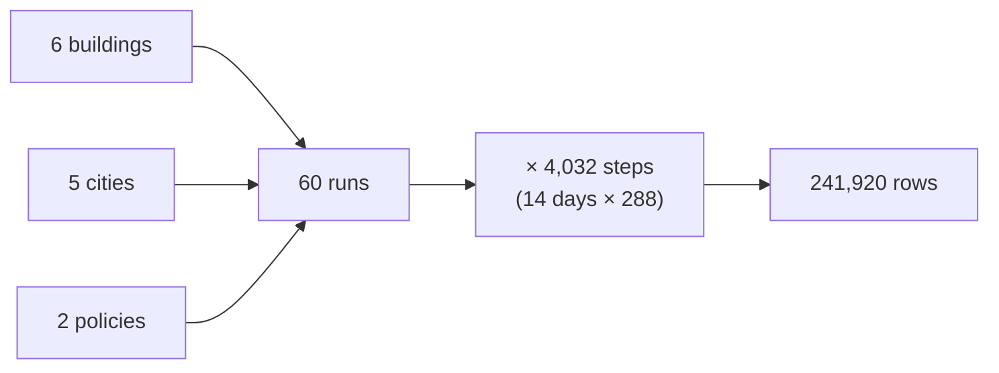
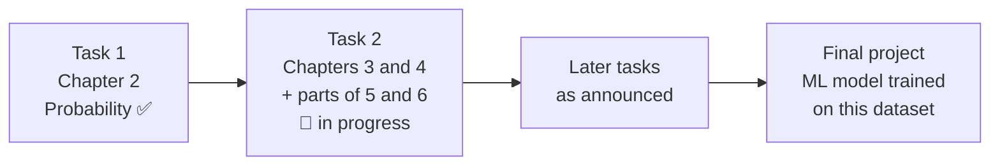

<div align="center">

# 🏢 Smart Buildings Under Pressure

### A statistics-driven study of HVAC controller penalties, built toward a machine-learning model for the **NeurIPS 2026 Smart Buildings** competition


[Competition page](https://www.kaggle.com/competitions/neurips-2026-smart-buildings) ·
[Competition data](https://www.kaggle.com/competitions/neurips-2026-smart-buildings/data) ·
[Task 1 notebook (Colab)](https://colab.research.google.com/drive/1qNRjvsrSk8ApVwwcXkFOhoLQcpRIS4W9)

</div>

---

## 📌 Table of contents

1. [The project in 60 seconds](#-the-project-in-60-seconds)
2. [The competition](#-the-competition)
3. [The dataset](#-the-dataset)
4. [🎯 Targets, features and expected output](#-targets-features-and-expected-output)
5. [Roadmap: from probability to a trained model](#-roadmap-from-probability-to-a-trained-model)
6. [What Task 1 already told us](#-what-task-1-already-told-us)
7. [Repository map](#-repository-map)
8. [Run it yourself](#-run-it-yourself)
9. [Team workflow and rules](#-team-workflow-and-rules)
10. [Limitations you must keep in mind](#-limitations-you-must-keep-in-mind)

---

## ⚡ The project in 60 seconds

Heating, ventilation and air conditioning (HVAC) is a large share of a building's energy use and carbon emissions. The **NeurIPS 2026 Smart Buildings** competition asks participants to build control policies that keep occupants comfortable while cutting energy cost and carbon, and that **still work on buildings and weather they have never seen**.

This repository is our course project for **Bio-statistics**. The instructor asked us to pick a competition dataset, apply the statistics of each chapter to it, one task at a time, and finish by **training a machine-learning model on the same data**. Every task therefore has two jobs: satisfy the course requirements, and move us one step closer to the final model.

| Question we keep asking | Why it matters |
|---|---|
| How likely is a 5-minute step to be **heavily penalised** (reward < −0.1)? | It is the simplest honest summary of how badly a baseline controller is doing. |
| **When** and **where** do penalties happen? | Occupancy, climate and controller type change the answer a lot (see [Task 1 findings](#-what-task-1-already-told-us)). |
| Which columns can **predict** the reward on an unseen building? | This decides the features of the final model. |

---

## 🏆 The competition

- **Goal:** build HVAC control policies that balance **occupant comfort, energy cost and carbon emissions** and **generalise to unseen buildings and weather**.
- **Scoring (per the competition's own description):** the leaderboard metric is the *mean absolute error against zero* of the reward, so **lower is better** and a perfect controller scores 0. The dataset stores the same idea in the column `run_score_abs_mean`.
- **Why a statistics course fits:** the reward is a per-step number, the data are simulator logs, and the central difficulty is *generalisation*. Choosing sensible splits, understanding distributions and avoiding leakage are statistics problems before they are machine-learning problems.

> The competition page itself is dynamic and may change. Treat the Kaggle links above as the source of truth for rules, dates and submission format.

---

## 📦 The dataset

**One file:** [`data/raw/combined_runs.csv`](data/raw/combined_runs.csv), about 84 MB.

| Property | Value |
|---|---|
| Rows × columns | **241,920 × 37** |
| One row is | **one 5-minute time step** of one simulation run |
| One run is | one building × one weather file × one controller, **4,032 steps = 14 days** |
| Runs | **60** = 6 buildings × 5 cities × 2 controller policies |
| Buildings | 6 training designs (`building_train_1, 2, 4, 5, 7, 8`), 2 to 4 floors, 30 to 85 zones |
| Cities (weather) | Atlanta, Denver, Fairbanks, Phoenix, Singapore |
| Policies | `pid_water` (baseline PID) and `noisy_pid_water` (PID with noise) |
| Missing values / duplicate rows | **0 / 0** |

### How the 241,920 rows are built



### The 37 columns in 8 groups

| Group | Columns | Meaning |
|---|---|---|
| **Identifiers** | `run_id`, `building`, `weather`, `policy`, `step`, `timestamp` | Which run and which moment. |
| **Conditions** (not controlled) | `occupancy`, `outside_air_temp_K` | What the building faces at this step. |
| **State** | `zone_temp_mean_K`, `zone_temp_min_K`, `zone_temp_max_K` | Measured zone temperatures. |
| **Outcome** | `reward` (higher is better, maximum 0) | The quantity the controller is judged on. |
| **Reward components** | `rc_*` (productivity, electricity, gas, carbon, normalised versions, `rc_total_occupancy`) | The ingredients the reward is computed from. |
| **Run summaries** | `run_total_reward`, `run_mean_reward`, `run_score_abs_mean`, `run_avg_occupancy`, `run_avg_zone_temp_K` | Constant within a run. |
| **Building specs** | `run_n_zones`, `run_n_floors`, `run_n_ahus`, `run_n_obs`, `run_n_cont_actions`, `run_n_disc_actions` | Constant within a building. |
| **Bookkeeping / constants** | `done`, `run_status`, `run_steps`, `run_size_mb`, `run_seconds` | No analytical value. |

> 💡 **Three layers, three sample sizes.** Step-level columns change every row; `run_*` columns repeat on every row of a run; building specs repeat on every row of a building. Averaging a repeated column over all rows counts each run 4,032 times. The honest sample sizes are **60 runs, 840 run-days and 6 buildings**, not 241,920.

---

## 🎯 Targets, features and expected output

This section fixes the plan for the **final machine-learning stage**. The choices below are our current recommended defaults, backed by evidence from the data. They will be confirmed with the instructor when the model stage starts, and the model family will be limited to what the course covers.

### 1 · Targets: what the model predicts

| Role | Target | Type | Definition | Why this one |
|---|---|---|---|---|
| **Primary** | `reward` | continuous, ≤ 0 | The reward at one 5-minute step (closer to 0 is better). | It is exactly what the competition judges. |
| **Secondary** | `HP` | binary | `1` if `reward < -0.1`, otherwise `0`. | Same event as Task 1 (about 20.07 % of steps), easy to interpret and to explain. |
| **Evaluation level** | `run_mean_reward` (and its absolute value) | continuous, 60 values | Mean reward of a whole run. | Mirrors the competition's per-run score. |

### 2 · Features: what the model learns from

**Tier A: scenario and context features** (known before the controller acts; our default feature set)

| Feature | Type | Why we expect it to help |
|---|---|---|
| `occupancy` | discrete count (0 to 160) | Strongest single signal: correlation with `reward` ≈ **−0.39**; penalty rate ≈ 50.3 % when occupied vs 2.1 % when empty. |
| `outside_air_temp_K` | continuous | Cold and hot extremes raise the penalty rate (Task 1: Fairbanks and Phoenix worst). |
| `hour` (0 to 23) and `WD` (weekday flag) | derived from `timestamp` | Occupancy follows a fixed Monday to Friday schedule, so the clock carries information. |
| `NOISY` (controller flag) | binary | Noisy policy has a higher penalty rate (22.7 % vs 17.4 %). |
| Building descriptors: `run_n_zones`, `run_n_floors`, `run_n_ahus`, `run_n_obs`, `run_n_cont_actions`, `run_n_disc_actions` | discrete | Describe size and complexity. ⚠️ Only **6 distinct buildings**: use with caution, they cannot be separated from building identity. |

**Tier B: state features** (optional second model)

| Feature | Note |
|---|---|
| `zone_temp_mean_K`, `zone_temp_min_K`, `zone_temp_max_K` | Measured at the same step. Informative (correlation with `reward` between about −0.15 and +0.20) but they are partly *consequences* of earlier control actions. Compare **Model A (Tier A only)** with **Model B (Tier A + B)** and report the difference. |

**Analysis-only columns** (used for description, *not* as model inputs by default): `city` (a label that will not exist for unseen weather; `outside_air_temp_K` carries the useful part), `building`, `weather`.

### 3 · Excluded columns: and the proof why

| Excluded | Reason |
|---|---|
| `rc_*` reward components, `rc_agent_reward`, `rc_productivity_reward` | **Target leakage.** We checked that `reward = 0.6·A − 0.2·B − 0.2·C` where A, B, C are `rc_normalized_productivity_regret`, `rc_normalized_energy_cost`, `rc_normalized_carbon_emission`. The largest gap over all 241,920 rows is about **6 × 10⁻⁶** (rounding). A model that sees these columns would just rebuild the formula and learn nothing about buildings. |
| `run_total_reward`, `run_mean_reward`, `run_score_abs_mean` | Computed *from* the target (`run_total_reward = run_mean_reward × 4,032`). |
| `run_avg_occupancy`, `run_avg_zone_temp_K` | Run-level averages of the same step columns; they would leak whole-run information into single steps. |
| `rc_total_occupancy` | Near-duplicate of `occupancy` (correlation ≈ 0.995). |
| `run_id`, `step`, `timestamp` | Identifiers. Only the derived `hour` and `WD` are used. |
| `done`, `run_status`, `run_steps` | Constant: no information. |
| `run_size_mb`, `run_seconds` | Simulation bookkeeping, not building behaviour. |

### 4 · Train and test split

Rows within a run are strongly autocorrelated, so a random row split would leak. We split **by building**:

- **Leave-one-building-out:** 6 folds (train on 5 buildings, test on the 6th).
- Or hold out 2 buildings: C(6, 2) = **15** possible splits.

This imitates the competition, where the final score comes from buildings the model has never seen. Each weather file belongs to exactly one building, so a building split also separates weather files.

### 5 · Expected output at the end

```
INPUT  (one 5-minute step of an UNSEEN building)         OUTPUT
──────────────────────────────────────────────────       ──────────────────────────────────────
occupancy            = 48                                predicted reward        ≈ −0.15   (≤ 0)
outside_air_temp_K   = 275.0           ──►  model  ──►   P(heavily penalised)    ≈ 0.62
hour = 10, WD = 1, NOISY = 0                             predicted run score     (mean over steps)
building specs, [zone temps for Model B]
```
*The numbers above are illustrative only, not real predictions.*

At the end of the project we will deliver:

1. **A trained model** (Model A, and Model B if time allows) and the exact code to retrain it.
2. **A predictions table** on every held-out building: actual vs predicted `reward` (and `HP`).
3. **A metrics table** per held-out building: step-level MAE for `reward`, run-level error for the predicted run mean, and accuracy for `HP`.
4. **Diagnostic plots:** predicted vs actual, error by occupancy state and by city, run-level comparison.
5. **A short honest conclusion:** does the model beat the baselines below on unseen buildings, and which features mattered?

**Reference baselines to beat** (leave-one-building-out, computed once with pure statistics; the notebook must reproduce them):

| Baseline | Meaning | Result (average over 6 held-out buildings) |
|---|---|---|
| Global mean | Predict the training mean reward for every step | step-level **MAE ≈ 0.0745** |
| Occupancy-conditional mean | Predict the mean reward given `occupancy > 0` | step-level **MAE ≈ 0.0467** |
| Never penalised | Predict `HP = 0` always | **accuracy ≈ 0.799** (the bar a classifier must clear) |

> A useful model must clearly beat **0.0467** step-level MAE on unseen buildings, and for `HP` it must beat 0.799 accuracy or, better, show it finds the penalised steps (not only the easy majority class).

---

## 🗺️ Roadmap: from probability to a trained model



| Stage | Content | Status |
|---|---|---|
| **Task 1** | Dataset understanding, preprocessing, Chapter 2 probability (events, counting, conditional probability, total probability, Bayes, independence), three-way validation, block-bootstrap uncertainty. | ✅ Done |
| **Task 2** | Chapters 3 and 4 (discrete and continuous random variables and distributions) plus the parts of Chapters 5 and 6 covered in lectures and tutorials (joint distributions, covariance, descriptive statistics). A ≤ 10-minute video is part of the submission. | 🔄 In progress. Team plan: [`Docs/Task2_Team_Guide.pdf`](Docs/Task2_Team_Guide.pdf) |
| **Later tasks** | Further chapters on the same dataset. | ⏳ Pending |
| **Final project** | Train and evaluate the ML model described [above](#-targets-features-and-expected-output). | ⏳ Pending |

**Course rule:** only methods and formulas covered in the lectures and tutorials may be used. Every statistical choice in the notebooks must be explainable from the course material.

---

## 🔍 What Task 1 already told us

All numbers come from the Task 1 notebook (241,920 steps, 60 runs). They describe **these simulated runs**, not real buildings.

| Finding | Number |
|---|---|
| Overall chance a step is heavily penalised, P(HP) | **0.2007** |
| P(HP \| occupied) vs P(HP \| empty) | **0.503** vs **0.021** (about 25× higher when occupied) |
| Share of penalised steps that happen while occupied | **93.6 %** |
| Occupied steps that are also cold | penalty rate rises from 0.438 to **0.750** |
| City ranking by P(HP) | Fairbanks **0.273** > Phoenix **0.247** > … > Atlanta **0.132** |
| Controller: noisy vs clean | **0.227** vs **0.174**; noisy run scores lower in **27 of 30** matched pairs |
| Building size | No upward trend (only 6 designs, so descriptive only) |
| Honest uncertainty of P(HP \| occupied) | naive ±0.003, but run-level interval roughly **0.43 to 0.58** |

**One-line story:** *occupied hours, extreme climates and the noisy controller are the hard cases; building size is not.*

---

## 🗂️ Repository map

```
smart-buildings-statistics-project/
├── README.md                          ← you are here
├── data/
│   └── raw/combined_runs.csv          ← THE dataset (241,920 × 37). Never edit.
├── Notebooks/
│   └── task1 notebook                 ← final Task 1 Colab notebook (Chapter 2)
└── Docs/
    ├── Task_01.pdf                    ← Task 1 assignment brief
    ├── Task01_Team07.pdf.pdf          ← Task 1 presentation slides
    └── Task2_Team_Guide.pdf           ← Task 2 member guide (add this file)
```

> **One dataset only.** `combined_runs.csv` is the dataset for every task and for the final model. Every document in this repository describes it.

## ▶️ Run it yourself

**Google Colab (recommended)**

1. Open the notebook in Colab.
2. Run **Runtime → Restart session and run all**.

The loader tries, in order: a local copy, the compressed or raw file on GitHub, the shared Drive folder `stats_project`, and finally an upload dialog.

**Minimal setup in any Python environment**

```python
import pandas as pd

RAW = "https://raw.githubusercontent.com/Jana-Hazem/smart-buildings-statistics-project/main/data/raw/combined_runs.csv"
df_raw = pd.read_csv(RAW)               # keep untouched
assert df_raw.shape == (241920, 37)
```

Libraries used: `pandas`, `numpy`, `matplotlib`, `scipy` (only to read standard distribution tables). Python is the only permitted language. All random numbers use **seed 42**.

---

## 🤝 Team workflow and rules

- **One master notebook.** Develop in personal copies (`T2_M1_draft`, `T2_M2_draft`, …) and merge into the master at the agreed time. Never edit the master at the same time.
- **Raw data is read-only.** `df_raw` is never modified; all work happens on copies (`df`).
- **Shared names are a contract.** Once published (`df`, `runs`, `hb`, `rd`, `spells`, event columns such as `OCC`, `HP`, `NOISY`, `WD`) they are never renamed.
- **Every application uses the same 5 parts:** question → events/variables and assumptions → rule or distribution and why it fits → calculation → interpretation.
- **Say "time steps", not "independent samples".** Consecutive steps in a run are autocorrelated.
- **Validate every key result** by at least two independent routes and explain any gap as *exact agreement* or *modelling difference*.
- **Fixed seed 42**, no absolute file paths, rerun from top to bottom before every submission.
- **Presenters rotate:** the presenter of each task must be a different team member until everyone has presented, but **every member must understand the whole task.**

---

## ⚠️ Limitations you must keep in mind

- **Simulation, not reality.** Two baseline PID controllers on simulated buildings, not real buildings and not learned policies.
- **Few independent units.** 6 building designs, 60 runs, 14-day windows. Conclusions about size or floors rest on 6 points.
- **Autocorrelation.** Neighbouring steps are alike. Row-level standard errors are far too small; use run-level or run-day-level reasoning.
- **Analyst thresholds.** HP (reward < −0.1), cold (< 283.15 K), hot (> 298.15 K) and others are our choices, not official limits. Changing them changes the level of the results, not their ordering.
- **Fixed occupancy schedule.** Occupancy follows a weekday timetable (including holidays), so it is partly a clock effect.
- **Descriptive, not causal.** Associations in simulated data do not prove that occupancy or the noisy controller *cause* penalties.
- **Hidden test set.** The competition scores buildings and weather we do not have; results on our 6 training buildings may not carry over.

---

<div align="center">

**Team 7 · Bio-statistics** · Built with Python, pandas, NumPy, SciPy and matplotlib

</div>
